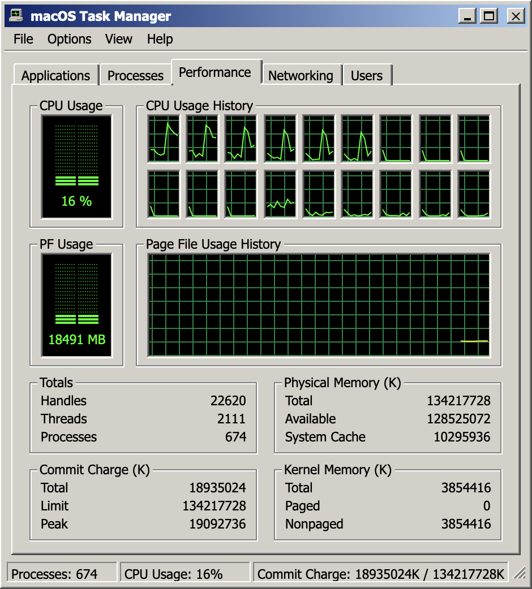
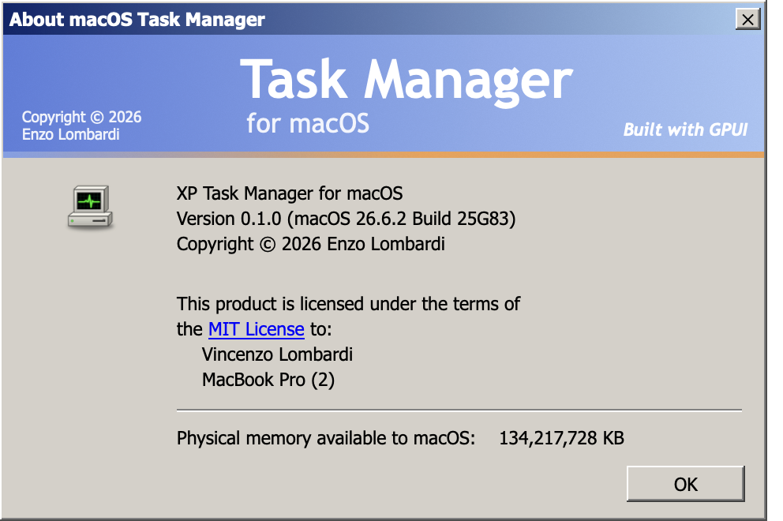

# XP Task Manager for macOS

A faithful recreation of the Windows XP Task Manager, running natively on macOS and showing your Mac's live data. Built in Rust with [GPUI](https://www.gpui.rs) and [gpui-component](https://github.com/longbridge/gpui-kit).

The idea comes from [TaskMgr98](https://github.com/jankammerath/TaskMgr98) by Jan Kammerath, a classic Task Manager for Windows 11 written in Go that matches the Windows XP one feature for feature.



## Features

- **Applications**: running apps, with End Task, Switch To and New Task (opens an app, file, folder or URL).
- **Processes**: image name, PID, user, CPU and memory, sortable by column, with "Show processes from all users" and End Process.
- **Performance**: CPU and page file meters, scrolling history graphs (one graph per CPU by default, tiled to fit), and the Totals, Physical Memory, Commit Charge and Kernel Memory counters.
- **Networking**: a self-scaling utilization graph per adapter, plus link speed and state.
- **Users**: logged-in sessions.
- **Tiny footprint mode**: double-click the Performance graphs to hide everything but the CPU charts; double-click again to restore.
- **Tray meter**: the CPU bar meter lives in the menu bar. With Options > Hide When Minimized (on by default), minimizing leaves only the meter, and its menu restores the window.
- **The rest of XP**: Windows Classic styling with square corners, the File/Options/View/Help menus, update speeds, kernel times, Always On Top, and an About box.



## How the numbers map

macOS has no page file or commit charge, so the closest Darwin equivalents stand in:

| XP counter | macOS source |
| --- | --- |
| Commit charge / PF usage | memory in use plus swap in use |
| Commit limit | physical memory plus swap size |
| System cache | file-backed pages |
| Kernel memory, nonpaged / paged | wired memory / compressor pool |
| Handles | open file descriptors |

Thread and handle totals only include processes the app is allowed to inspect.

## Install

Download `XP-Task-Manager-<version>.dmg` from [Releases](https://github.com/aovestdipaperino/xp-taskmgr/releases) and drag **Task Manager** to Applications. The app is ad-hoc signed, not notarized, so on first launch right-click it and choose **Open**.

## Build

Requires macOS 11 or later and a recent Rust toolchain.

```sh
cargo run --release      # run from source
scripts/bundle.sh        # build dist/Task Manager.app and the DMG
```

Set `SIGN_ID="Developer ID Application: ..."` before running `scripts/bundle.sh` to sign with your own identity. `scripts/make_icon.py` (needs Pillow) regenerates the app icon.

## License

MIT. Windows and Windows XP are trademarks of Microsoft Corporation; this project is not affiliated with or endorsed by Microsoft and uses none of its logos or artwork.
